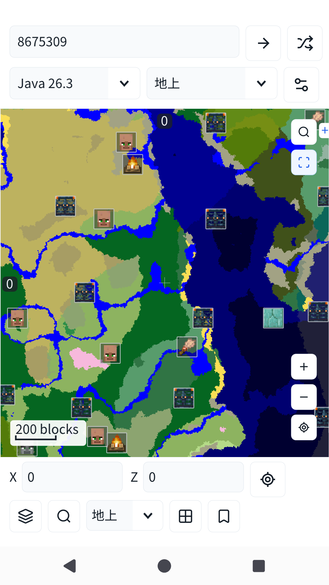
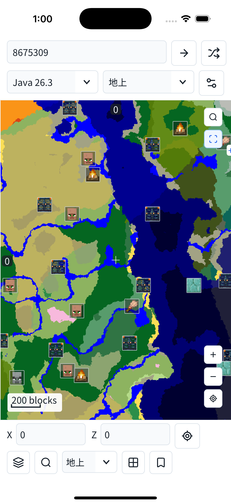

# SeedLens

An offline biome and structure map for Minecraft Java and Bedrock on Windows, Android and iOS. Written in C++.

**[Windows EXE](https://github.com/1y23qq/SeedLens/releases/latest/download/SeedLens.exe)** · **[Android APK](https://github.com/1y23qq/SeedLens/releases/latest/download/SeedLens.apk)** · **[iOS IPA (requires signing)](https://github.com/1y23qq/SeedLens/releases/latest/download/SeedLens-unsigned.ipa)** · [Coverage and verification](docs/VERIFICATION.md)

The Windows application is a single EXE of approximately 4.9 MiB. It requires no Java or Python runtime, WebView, additional DLLs, or network connection. Supported platforms are Windows 10 / 11 x64, Android 8+, and iOS / iPadOS 15+. The standard Android APK targets ARM64 devices. The IPA is unsigned and requires an appropriate Apple signing identity and provisioning profile or a compatible re-signing workflow before installation.

The iOS application has not been tested on physical devices. Final runtime verification of its updated export and sharing interface is also incomplete because the hosted CI simulator stopped responding. See the [verification record](docs/VERIFICATION.md) for details.

 

## Features

- Separate native generation engines for Java and Bedrock.
- Overworld, Nether and End maps, with adjustable Y levels for underground biomes.
- Drag to pan, zoom around the pointer, jump to coordinates, and locate the estimated world spawn.
- Structure layer toggles, structure searches, results ordered by distance, biome highlighting and biome location searches.
- Villages, temples, swamp huts, igloos, ocean monuments, woodland mansions, outposts, ruined portals, ancient cities, buried treasure, mineshafts, strongholds, shipwrecks, ocean ruins, trail ruins, trial chambers, abandoned camps, Nether fortresses, bastions, End cities, and more.
- Details including End ships, abandoned villages, igloo basements, bastion variants, and dried ghasts in supported Java Nether fossils.
- Chunk boundaries, slime chunks for both editions, and 8:1 coordinate conversion between the Overworld and Nether.
- Bookmarks associated with their seed, edition, version and dimension.
- PNG map exports, CSV exports of search results or visible structures, and copying of coordinates and teleport commands.
- A light theme, Japanese / English UI, and embedded Noto Sans JP fonts. Structure markers use actual Minecraft textures; controls and the application icon use Lucide.
- Tile generation and caching with up to four workers. Zooming preserves the pointer position and keeps cached tiles visible while new tiles are generated. Structure searches run on a separate worker.
- Mobile builds share the same engines, UI, colors, fonts and textures. Layouts adapt to portrait and landscape screens, tablets, safe areas and on-screen keyboards. Pan with one finger, pinch to zoom, and long-press for location details. PNG / CSV exports use native saving and sharing interfaces. iOS also saves copies under Files > SeedLens > Exports.

## Coverage

Java includes 35 generation profiles representing versions 1.0 through 26.3. Bedrock includes 28 profiles representing versions 1.0 through the 26.60 family. Java Beta 1.7 / 1.8 support is experimental. Individual patches and snapshots are not all emulated separately.

**Not every structure type is supported.** Overworld fossils, Java monster rooms and Bedrock Nether fossils are currently not predicted. Java ravines and lava lakes are not exposed as map layers. Bedrock monster room searches require version 1.18+ and are limited to a radius of 128 blocks.

Bedrock 26.30 / 26.40 / 26.60 use generation implementations derived from previews. Exact parity with final 26.60–26.63 releases has not been verified; these profiles are marked with * in the application. They are not presented as a guarantee of accuracy for the latest final release.

Maps display biome slices at the selected Y level, rather than fully reproducing terrain blocks or elevation. Terrain-dependent temples and mansions, some decorations, and spawn locations include approximations. Edited chunks, custom world generation, mods and datapacks are not modeled. For details, open Help & coverage > Coverage from the ? button or the mobile menu.

## Getting started

1. Launch the application and choose the edition, version and seed.
2. Press Enter in the seed field or use the arrow button to apply it.
3. Drag to pan and use the mouse wheel to zoom. Use the X / Z fields to jump to coordinates.
4. Toggle structure layers or open Find locations to search.
5. Select a structure for details. Right-click the map to copy coordinates or save a bookmark.

On touch screens, pan with one finger, pinch with two fingers, and long-press the map for location details.

Use Y=320 for surface biomes, or Y=0 / -32 for caves. Selecting a biome in the list highlights that biome. Slime chunks appear when zoomed to 2 blocks per pixel or closer.

Dense layers are scanned in views up to 8,192 blocks wide; ordinary structure overlays are scanned in views up to 65,536 blocks wide. The application indicates when a result limit is reached. Biome searches sample locations at 32-block intervals and do not calculate the exact nearest biome boundary.

Keyboard shortcuts: Ctrl+L for the seed field, Ctrl+F to search, Ctrl+B for bookmarks, Ctrl+S to export PNG, Home to return to the origin, + / - to zoom, G to toggle chunk boundaries, and F1 for help.

Windows settings are saved in LocalAppData/SeedLens/session.ini. To store them beside the EXE instead:

    SeedLens.exe --portable

## Command line

The Windows EXE can generate maps and search without opening the GUI. Seeds can be signed 64-bit integers or strings. Out-of-range numeric seeds are rejected. String seeds use Java-compatible UTF-16 hashing.

    SeedLens.exe --self-test --output result.json
    SeedLens.exe --edition java --versions --output versions.txt
    SeedLens.exe --edition java --version 26.3 --seed -3829811542736183482 --query 68148 77 80990 --output biome.json
    SeedLens.exe --edition bedrock --seed 8675309 --dimension nether --at 0 0 --export nether.png --width 1024 --height 768 --scale 4
    SeedLens.exe --edition java --seed 8675309 --scan villages.csv --kind village --radius 4096
    SeedLens.exe --edition java --dimension end --seed 8675309 --scan cities.csv --kind end-city --radius 4096

Dimensions are overworld / nether / end. Image sampling scales are 1 / 4 / 16 / 64 / 256 blocks per pixel. PNG exports support dimensions up to 4096×4096. Structure searches cover a square area with a maximum radius of 32,768 blocks. CSV files include structure types, coordinates, known Y levels, biomes and detail flags. Unknown Y values are left blank. See [src/backend.h](src/backend.h) for flag definitions.

## Building from source

Windows requirements:

- Windows x64
- Python 3.10+ (build time only; no pip packages required)
- [w64devkit 2.11.0](https://github.com/skeeto/w64devkit/releases/tag/v2.11.0) (verified with GCC 16.2.0)

The application uses C++20. Extract w64devkit and set SEEDLENS_TOOLCHAIN to its bin directory, or add that directory to PATH. The build script also detects .cache/toolchain/w64devkit/bin inside the repository.

    python scripts/build.py --upstream-tests
    python tests/integration.py

Output: build-native/SeedLens.exe. Required C/C++ sources, generation tables, UI code and generated icon data are included in the repository. Normal Windows builds require no network access once the compiler is available. An optional CMake project is also included.

Regenerating icons requires scripts/generate_icons.py and Pillow / svg.path. These are not needed for normal builds or at runtime.

See [mobile/README.md](mobile/README.md) for mobile build and signing instructions. The application runs offline on every platform. The Android build does not request Internet permission.

## Project layout

- src/engine.*: Generation contexts, tile workers, searches, biome information and layers.
- src/backend_*: Adapters connecting each edition's C engine to a shared API.
- src/ui.cpp: Native Japanese / English interface.
- src/main.cpp: Win32, DirectX and the Windows EXE's command-line interface.
- src/mobile_main.cpp / mobile/: SDL3 host, Android Activity, iOS exports and mobile build configuration.
- src/export.cpp / persistence.cpp: Windows WIC PNG encoding, CSV output and settings persistence.
- third_party/: Pinned generation engines, Dear ImGui, upstream tests and licenses.
- assets/lucide/: Original Lucide SVG files.
- assets/fonts/: Noto Sans JP subsets and the OFL license.
- assets/chunkbase-biome-colors.json: 93 colors checked against the actual biome legend.
- assets/minecraft/: Minecraft image sources and hashes. The marker atlas is embedded in the application.

## License

SeedLens source code is licensed under the MIT License. Minecraft images remain the property of Mojang / Microsoft and are excluded from that license. See [UPSTREAM.md](third_party/UPSTREAM.md) for dependency versions and local changes, and [THIRD_PARTY_NOTICES.txt](THIRD_PARTY_NOTICES.txt) for the full notices. The notices are also embedded in the application.

NOT AN OFFICIAL MINECRAFT PRODUCT. NOT APPROVED BY OR ASSOCIATED WITH MOJANG OR MICROSOFT.
