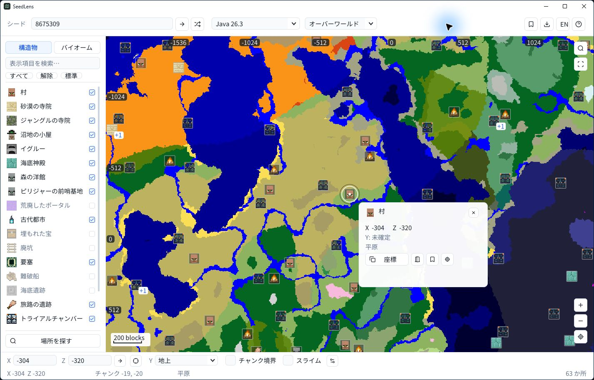

# SeedLens

Minecraft Java / Bedrock用の、オフラインで動くバイオーム・構造物マップ。C++20、Win32、DirectX 11製のWindowsアプリです。

**[SeedLens.exeをダウンロード](https://github.com/1y23qq/SeedLens/releases/latest/download/SeedLens.exe)** · [リリース](https://github.com/1y23qq/SeedLens/releases) · [対応範囲と検証](docs/VERIFICATION.md)

配布は約4.9MiBのexe一つ。インストール、Java、Python、WebView、追加DLL、ネット接続は不要です。Windows 10 / 11 x64に対応します。

## 機能

- Java / Bedrockそれぞれ専用のネイティブ生成エンジン。
- オーバーワールド、ネザー、ジ・エンド。Y座標を変えて地下バイオームも表示。
- ドラッグ移動、マウス位置を基準にしたズーム、座標ジャンプ、推定スポーン地点。
- 構造物別の表示切替、検索、距離順の結果、バイオームのハイライトと地点検索。
- 村、寺院、小屋、イグルー、海底神殿、洋館、前哨基地、ポータル、古代都市、宝、廃坑、要塞、難破船、海底遺跡、旅路の遺跡、トライアルチャンバー、Abandoned Camp、ネザー要塞、砦、エンドシティなど。
- エンドシップ、ゾンビ村、イグルーの地下室、砦の種類、対応するJava版ネザー化石の乾燥したガストを表示。
- チャンク境界、両エディションのスライムチャンク、ネザーとの8:1座標変換。
- シード・版・バージョン・ディメンションと結び付いたブックマーク。
- 地図のPNG保存、検索結果・表示範囲の構造物のCSV出力、座標・テレポートコマンドのコピー。
- ライトテーマ、日本語 / English、埋め込みNoto Sans JP。構造物はMinecraftの実際のテクスチャ、操作アイコンとexeアイコンはLucideを使用。
- 必要なタイルを最大4ワーカーで生成し、キャッシュします。ズームはマウス位置を保って滑らかに動き、生成中もキャッシュ済みの地図を表示します。構造物検索も別ワーカーで実行します。

## 対応範囲

Javaは1.0～26.3の35生成プロファイル、Bedrockは1.0～26.60系の28生成プロファイルを収録しています。JavaのBeta 1.7 / 1.8は実験的です。全パッチと全スナップショットを個別再現するものではありません。

**完全な全構造物対応ではありません。** 現在、オーバーワールドの化石、Javaのモンスタールーム、Bedrockのネザーの化石は予測しません。Javaの峡谷・溶岩湖もレイヤー対象外です。Bedrockのモンスタールームは1.18以降で半径128ブロック以内の検索に対応します。

Bedrockの26.30 / 26.40 / 26.60はプレビュー由来の生成実装です。26.60～26.63の正式版との完全一致は未検証で、アプリ内でも * を付けて表示します。最新版の正確性を保証する表記にはしていません。

マップは選択したY座標のバイオームを表示します。地形のブロック形状や標高を完全再現するものではありません。地形条件のある寺院・洋館、一部の装飾物、スポーン地点は近似を含みます。生成済みチャンクの編集、カスタム生成、MOD、データパックは対象外です。詳しくは右上の「?」→「対応範囲・精度」を参照してください。

## 使い方

1. exeを起動し、Java / Bedrock、バージョン、シードを選択します。
2. シード欄でEnter、または矢印ボタンで適用します。
3. ドラッグで移動し、ホイールで拡大縮小します。X / Z欄から座標へ移動できます。
4. 左の構造物レイヤーを切り替えるか、「場所を探す」で検索します。
5. 構造物をクリックして詳細を表示。右クリックでコピーやブックマーク保存ができます。

バイオームは地上を見るならY=320、洞窟はY=0や-32が便利です。バイオーム一覧をクリックすると、その種類だけを強調します。スライムチャンクは2 blocks/pixel以下まで拡大すると表示されます。

密集するレイヤーは表示幅8192ブロック以内、通常の構造物は65536ブロック以内の表示範囲で検索します。結果上限に達した場合は画面に表示します。バイオーム検索は32ブロック間隔のサンプル地点を探すため、厳密な最近傍境界の計算ではありません。

ショートカット: Ctrl+L シード、Ctrl+F 検索、Ctrl+B ブックマーク、Ctrl+S PNG、Home 原点、+ / - ズーム、G チャンク境界、F1 ヘルプ。

設定はLocalAppData/SeedLens/session.iniに保存します。exeの横に保存したい場合:

    SeedLens.exe --portable

## コマンドライン

GUIと同じexeで、画面を開かずに生成・検索できます。シードは符号付き64ビット整数または文字列です。数値として範囲外のシードはエラーにします。文字列はJava互換のUTF-16ハッシュを使います。

    SeedLens.exe --self-test --output result.json
    SeedLens.exe --edition java --versions --output versions.txt
    SeedLens.exe --edition java --version 26.3 --seed -3829811542736183482 --query 68148 77 80990 --output biome.json
    SeedLens.exe --edition bedrock --seed 8675309 --dimension nether --at 0 0 --export nether.png --width 1024 --height 768 --scale 4
    SeedLens.exe --edition java --seed 8675309 --scan villages.csv --kind village --radius 4096
    SeedLens.exe --edition java --dimension end --seed 8675309 --scan cities.csv --kind end-city --radius 4096

ディメンションはoverworld / nether / end。画像のscaleは1 / 4 / 16 / 64 / 256 blocks/pixelです。PNGは最大4096×4096、構造物検索は最大半径32768の正方形範囲です。CSVには種別、座標、判定済みのY、バイオーム、詳細フラグを収録します。Yが未確定の場合は空欄です。フラグはsrc/backend.hを参照してください。

## ソースからビルド

必要なもの:

- Windows x64
- Python 3.10以降（ビルド時のみ。pipパッケージは不要）
- [w64devkit 2.11.0](https://github.com/skeeto/w64devkit/releases/tag/v2.11.0)（検証にはGCC 16.2.0を使用）

w64devkitを任意の場所へ展開し、そのbinディレクトリーをSEEDLENS_TOOLCHAIN環境変数に設定するかPATHへ追加してください。リポジトリー内の.cache/toolchain/w64devkit/binも自動検出します。

    python scripts/build.py --upstream-tests
    python tests/integration.py

出力はbuild-native/SeedLens.exeです。C/C++の全ソース、生成テーブル、UI、アイコンの生成済みデータはリポジトリー内に含まれ、通常のビルドはネット接続不要です。オプションのCMakeプロジェクトも同梱しています。

アイコンを再生成するときだけ、scripts/generate_icons.pyとPillow / svg.pathを使用します。通常のビルド・実行では使用しません。

## 構成

- src/engine.*: 生成コンテキスト、タイルワーカー、検索、バイオーム・レイヤー情報。
- src/backend_*: 両エディションのCエンジンを共通APIに接続。
- src/ui.cpp: 日本語 / EnglishのネイティブUI。
- src/main.cpp: Win32、DirectX、同一exeのCLI。
- src/export.cpp / persistence.cpp: Windows WICによるPNG、CSV、設定の保存。
- third_party/: ピン留めした生成エンジン、Dear ImGui、元のテストとライセンス。
- assets/lucide/: Lucideの元SVG。
- assets/fonts/: Noto Sans JPのサブセットとOFLライセンス。
- assets/chunkbase-biome-colors.json: 実際の凡例で確認した93色。
- assets/minecraft/: Minecraftの画像の出典・ハッシュ。画像アトラスはexeに埋め込まれます。

## ライセンス

SeedLensのソースコードはMIT Licenseです。Minecraftの画像はMojang / Microsoftに権利が残り、MIT Licenseの対象外です。依存ソースの版・ローカル変更は[UPSTREAM.md](third_party/UPSTREAM.md)、全文は[THIRD_PARTY_NOTICES.txt](THIRD_PARTY_NOTICES.txt)を参照してください。全文はexeにも埋め込まれています。

NOT AN OFFICIAL MINECRAFT PRODUCT. NOT APPROVED BY OR ASSOCIATED WITH MOJANG OR MICROSOFT.
